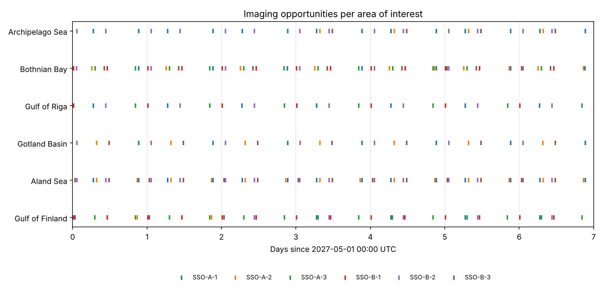

# sarverify: requirements verification for SAR satellite missions

A customer signs a contract for a SAR constellation with requirements like *"revisit every area of interest within 12 hours"* and *"deliver 90% of images within 2 hours of acquisition"*. Before the mission can be accepted, somebody has to show, requirement by requirement, that the system design actually meets them, how much margin there is, and what happens when something goes wrong.

`sarverify` does that verification by analysis. It takes a mission definition (constellation, SAR sensor envelope, areas of interest, ground stations, operations timeline and the customer requirements) and produces:

- a **requirements verification matrix** with measured worst case, margin and PASS / MARGINAL / FAIL per requirement,
- **coverage, revisit and delivery latency** statistics per area of interest,
- a **single-satellite loss analysis** showing which requirements depend on full constellation availability,
- a **trade study** over constellation size to find the smallest compliant design,
- machine-readable JSON and a non-zero exit code on failure, so verification can run as an **acceptance gate in CI**.

The goal is the part of mission delivery between "contract signed" and "mission accepted": turning requirements into something that can be checked automatically every time the design changes.

## Quick start

```bash
pip install -e ".[dev]"
sarverify run examples/baltic_maritime.yaml --out reports
sarverify trade examples/baltic_maritime.yaml --counts 2 3 4 5
sarverify trade examples/baltic_maritime.yaml --altitudes 500 560 620 700
pytest
```

## Example: Baltic maritime surveillance

The example in [`examples/baltic_maritime.yaml`](examples/baltic_maritime.yaml) is a fictional customer that wants a maritime picture over six Baltic Sea areas, served by six SAR satellites in two sun-synchronous planes at 560 km and two polar ground stations (Svalbard and Inuvik).

```
Baltic Maritime Awareness: 6 satellites, 248 opportunities, 938 contacts
  MR-COV-001  PASS      worst 10.65 h at Archipelago Sea
  MR-COV-002  PASS      worst 6.07 h at Gotland Basin
  MR-COV-003  PASS      worst 4.00 1/day at Gotland Basin
  MR-LAT-001  MARGINAL  worst 110.37 min at Bothnian Bay
  MR-GND-001  PASS      worst 189.36 min at SSO-B-3
  Single-satellite loss: 6/6 cases break at least one requirement
Acceptance status: MARGINAL
```

Full report: [`docs/example_output/verification_report.md`](docs/example_output/verification_report.md)



### What the analysis tells a program team

1. **Coverage is compliant but has no redundancy.** Revisit has about 11-14% margin, but losing any single satellite breaks the coverage requirements. That is a schedule and risk item: an on-orbit spare or a launch slot for a replacement should be in the risk register before acceptance.
2. **Latency is the real risk.** P90 latency is 110 min against a 120 min requirement (8% margin, reported MARGINAL). The cause is ground segment geometry, not the satellites: images taken over the Baltic wait for the next Svalbard or Inuvik pass.
3. **The fix is cheaper on the ground than in orbit.** [`examples/baltic_maritime_local_station.yaml`](examples/baltic_maritime_local_station.yaml) adds one station in southern Finland. P90 latency drops from 110 min to 23 min and the mission passes with every requirement above margin. The trade study shows that adding satellites does not move latency at all:

| Sats/plane | Total | Status | Max revisit (h) | Mean revisit (h) | Opportunities/day | P90 latency (min) |
|---|---|---|---|---|---|---|
| 2 | 4 | FAIL | 23.20 | 10.26 | 2.43 | 110.36 |
| 3 | 6 | MARGINAL | 10.65 | 6.07 | 4.00 | 110.37 |
| 4 | 8 | MARGINAL | 9.29 | 2.99 | 8.00 | 110.39 |

4. **560 km is a poor altitude for this customer.** At 560 km a sun-synchronous satellite makes 15.00 revolutions per day, so it is almost exactly a one-day repeat orbit: every day the constellation flies the same ground tracks, and an area that falls between tracks stays between them. Gotland Basin and the Gulf of Riga get only 4 opportunities per day. Moving the same six satellites to 620 km (14.81 rev/day) breaks the resonance, tracks drift from day to day, and the worst area gets 7 opportunities per day with mean revisit falling from 6.1 h to 3.4 h. The cost is slightly worse latency and a higher launch energy, which is the conversation to have with the customer:

```bash
sarverify trade examples/baltic_maritime.yaml --altitudes 500 560 620 700
```

| Altitude (km) | Rev/day | Max revisit (h) | Mean revisit (h) | Opportunities/day (worst AOI) | P90 latency (min) |
|---|---|---|---|---|---|
| 500 | 15.20 | 10.53 | 4.31 | 5.57 | 109.5 |
| 560 | 15.00 | 10.65 | 6.07 | 4.00 | 110.4 |
| 620 | 14.81 | 9.74 | 3.44 | 7.00 | 111.2 |
| 700 | 14.56 | 9.90 | 3.24 | 7.43 | 112.4 |

## How it works

```
mission.yaml ──► config ──► orbit propagation (J2) ──► ECEF positions/velocities
                                     │
                     ┌───────────────┼──────────────────┐
                     ▼               ▼                  ▼
            SAR access (zero-   ground station     delivery latency
            Doppler + incidence  contacts (elev.    (first contact that
            + look side)         mask)              fits the downlink)
                     └───────────────┼──────────────────┘
                                     ▼
                     metrics per AOI / per satellite
                                     ▼
              verification matrix, margins, loss cases, trade study
                                     ▼
                     Markdown + JSON report, CI exit code
```

| Module | Responsibility |
|---|---|
| `orbit.py` | Circular orbits with secular J2 drift, sun-synchronous inclination solver |
| `geodesy.py` | WGS84 geodetic to ECEF, GMST, ECI to ECEF, elevation |
| `access.py` | SAR imaging opportunities: zero-Doppler crossing detection with sub-step interpolation, incidence angle and left/right look filtering |
| `ground.py` | Ground station contact windows and acquisition-to-delivery latency |
| `analysis.py` | Runs the full simulation for a mission configuration |
| `metrics.py` | Registry of verifiable metrics (revisit, access rate, latency, contact time) |
| `verify.py` | Margin computation, PASS / MARGINAL / FAIL classification, worst-case summary |
| `degradation.py` | Re-verification with each satellite removed |
| `trade.py` | Constellation size and orbit altitude sweeps |
| `report.py`, `plots.py`, `cli.py` | Outputs and command line |

### Modelling choices

- **Imaging opportunity = zero-Doppler crossing.** A stripmap SAR images a target when it passes broadside. The tool finds the sign change of the range rate between target and satellite in the Earth-fixed frame, interpolates the crossing time, then checks incidence angle and look side against the sensor envelope. This gives exact opportunity times independent of the time step, instead of counting samples inside a swath.
- **J2 matters for SAR missions.** Sun-synchronous orbits exist only because of J2 nodal precession, and RAAN drift changes plane spacing over weeks. The propagator includes secular J2 terms and solves the SSO inclination for a given altitude (97.63 deg at 560 km).
- **Margins, not just pass/fail.** A requirement met with 2% margin is a different program risk than one met with 50%. Results inside a configurable band (default 10%) are flagged MARGINAL, and the CLI can be set to fail on MARGINAL with `--fail-on marginal`.
- **Requirements are data.** Each requirement has an id, metric, comparator, threshold, verification method and rationale, so the YAML file doubles as a traceable requirements baseline.

### Limitations

Analytical J2 propagation without drag; no tasking conflicts, duty cycle or power limits; latency assumes the satellite downlinks the image at the first suitable contact. These are stated in every generated report. The architecture keeps propagation behind a single function so a TLE/SGP4 or high-fidelity propagator can replace it without touching verification logic.

## Mission configuration

```yaml
mission:   { name, customer, epoch, duration_days, step_s }
constellation:
  planes:  [{ name, altitude_km, inclination_deg: sso | <deg>, raan_deg, satellites, phase_offset_deg }]
sensor:    { incidence_min_deg, incidence_max_deg, look_sides: [left, right] }
targets:   [{ name, lat_deg, lon_deg }]
ground_stations: [{ name, lat_deg, lon_deg, min_elevation_deg }]
operations: { downlink_duration_min, processing_min, min_contact_s }
verification: { marginal_band }
requirements:
  - { id, title, metric, comparator: "<=" | ">=", threshold, rationale }
```

Available metrics: `max_revisit_h`, `mean_revisit_h`, `daily_access_rate`, `latency_p90_min`, `delivered_fraction` (per area of interest), `daily_contact_min`, `daily_contact_count` (per satellite).

## Testing

The test suite checks the physics against known values (SSO inclination, nodal period, GMST at J2000, WGS84 radii), the access geometry against hand-computed flybys, latency edge cases, margin and classification logic, and the end-to-end pipeline including the property that losing a satellite never improves revisit. Because `sarverify run` exits non-zero when a requirement fails, the same command can gate a CI pipeline whenever the mission design changes.

## License

MIT
