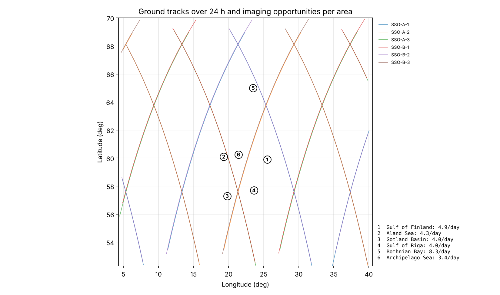
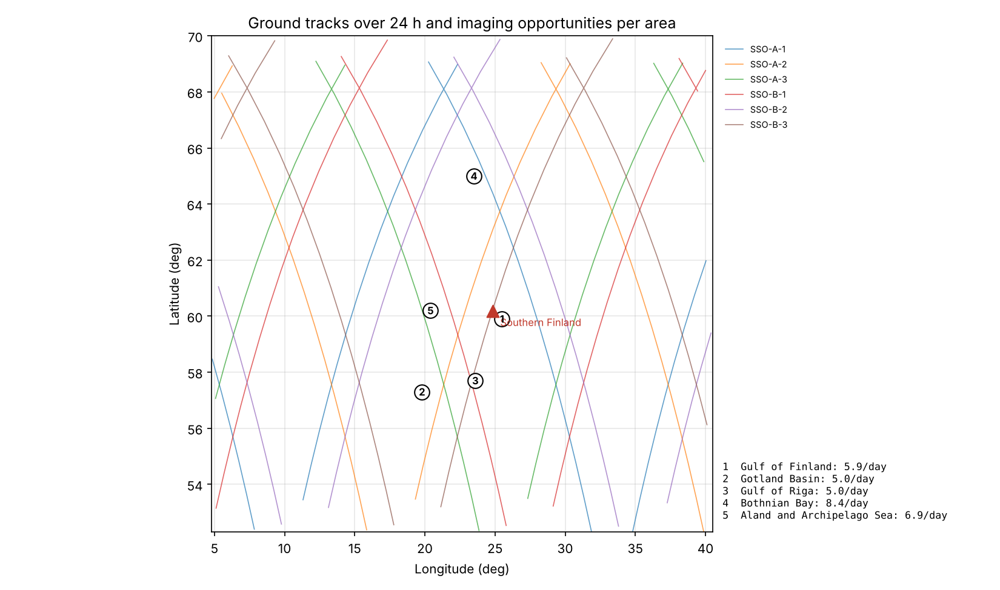

# sarverify: requirements verification for SAR satellite missions

A customer signs a contract for a SAR constellation with requirements like *"revisit every area of interest within 12 hours"* and *"deliver 90% of images within 2 hours of acquisition"*. Before the mission is accepted, somebody has to show requirement by requirement that the design meets them, how much margin there is, what happens when something goes wrong, and which change fixes a failing requirement at the lowest cost.

`sarverify` does that verification by analysis. Given a mission definition (constellation, SAR sensor envelope, areas of interest, ground stations, operations limits and the customer requirements) it produces:

- a **requirements verification matrix** with worst case, margin and PASS / MARGINAL / FAIL, plus a CSV traceability matrix,
- **coverage, revisit and delivery latency** per area of interest, with **tasking conflicts** between nearby areas resolved by a scheduler,
- a **single-satellite loss analysis**,
- **trade studies** over constellation size, orbit altitude and inter-plane phasing,
- an **option comparison** that writes a decision memo,
- a **Monte Carlo robustness analysis** over satellite phasing errors, used to derive a phasing accuracy requirement,
- JSON output and a non-zero exit code on failure, so verification can gate a CI pipeline.

## Quick start

```bash
pip install -e ".[dev]"
pytest

sarverify run examples/baltic_maritime.yaml --out reports
sarverify compare examples/baltic_maritime*.yaml --out reports
sarverify trade examples/baltic_maritime_option_b.yaml --phase-offsets 0 30 60 90
sarverify trade examples/baltic_maritime_option_c.yaml --counts 3 4 5
sarverify trade examples/baltic_maritime.yaml --altitudes 500 560 620 700
sarverify robustness examples/baltic_maritime_option_d.yaml --samples 100 --phase-sigma 5
```

## Worked example: Baltic maritime surveillance

A fictional coastal authority wants a maritime picture over six Baltic Sea areas. The baseline design is six SAR satellites in two sun-synchronous planes at 560 km, downlinking to Svalbard and Inuvik. Satellites need at least 20 s between acquisitions to slew and settle. All outputs below are in [`docs/example_output`](docs/example_output).

### Step 1: the baseline fails, and the reason is not obvious

```
Baltic Maritime Awareness, option A (baseline): 6 satellites, 202 opportunities, 938 contacts
  MR-COV-001  FAIL      worst 18.64 h at Archipelago Sea
  MR-COV-002  FAIL      worst 7.13 h at Archipelago Sea
  MR-COV-003  FAIL      worst 3.43 1/day at Archipelago Sea
  MR-LAT-001  MARGINAL  worst 110.37 min at Bothnian Bay
  MR-GND-001  PASS      worst 189.36 min at SSO-B-3
Acceptance status: FAIL
```

Counting geometric opportunities alone, the baseline passes every coverage requirement. It fails once the 20 s slew limit is applied: Åland Sea and Archipelago Sea are about 120 km apart and are often seen within seconds of each other on the same pass, so one of them loses the acquisition. 46 of 248 opportunities are lost to conflicts.

The coverage map shows a second problem. At 560 km a sun-synchronous satellite makes 15.00 revolutions per day, so the orbit repeats its ground track every day. With three satellites spaced 120 deg in each plane, the six satellites end up flying only a few distinct tracks, and areas between those tracks stay between them every day.

| Option A: tracks shared | Option D: tracks spread |
|---|---|
|  |  |

### Step 2: fix one thing at a time and compare

| Option | Change | Max revisit (h) | Mean revisit (h) | Opportunities/day | P90 latency (min) | Status |
|---|---|---|---|---|---|---|
| A | Baseline | 18.64 | 7.13 | 3.43 | 110.4 | FAIL |
| B | + ground station in southern Finland | 18.64 | 7.13 | 3.43 | 23.0 | FAIL |
| C | + second plane rephased from 60 to 90 deg | 14.65 | 5.86 | 4.14 | 23.0 | FAIL |
| D | + Åland and Archipelago Sea tasked as one acquisition | 10.28 | 4.84 | 5.00 | 23.0 | **PASS** |

Full decision memo: [`decision_memo.md`](docs/example_output/decision_memo.md)

- **Latency is a ground segment problem.** Images over the Baltic wait for the next polar station pass. One local station cuts P90 latency from 110 min to 23 min. No number of extra satellites changes this.
- **Phasing is free.** Moving the second plane's in-plane phase offset from 60 to 90 deg breaks the shared ground tracks and raises the worst area from 3.4 to 4.1 opportunities per day without new hardware ([`trade_phasing.md`](docs/example_output/trade_phasing.md)).
- **The last failure is a tasking conflict, not a coverage gap.** Option C still misses the 12 h maximum revisit at Archipelago Sea. Buying satellites fixes it, but takes 10 instead of 6 ([`trade_satellites_option_c.md`](docs/example_output/trade_satellites_option_c.md)). Agreeing with the customer to image Åland and Archipelago Sea as one acquisition fixes it with the existing six. That is a conversation with the customer, and the analysis gives the numbers for it.
- **Altitude alone does not help here.** Moving off the 560 km repeat orbit improves mean revisit, but maximum revisit gets worse at 620-700 km because the conflicts remain ([`trade_altitude.md`](docs/example_output/trade_altitude.md)).

### Step 3: is option D robust, and what does it require?

Option D passes nominally, but the margin depends on satellite phasing. A Monte Carlo over in-plane phasing errors shows how fragile that is:

| Phasing error (1 sigma) | P(all requirements met) |
|---|---|
| 1 deg | 100% |
| 2 deg | 100% |
| 5 deg | 99% |
| 10 deg | 83% |
| 15 deg | 47% |

This becomes a **derived requirement** for the space segment: keep in-plane phasing within about 5 deg (1 sigma) of nominal, which sets the commissioning and station-keeping budget. The single-satellite loss analysis adds a residual risk: losing any of 5 of the 6 satellites breaks at least one requirement, so spare capacity or replacement lead time belongs in the risk register.

## How it works

```
mission.yaml ─► config ─► orbit propagation (J2) ─► ECEF positions and velocities
                                   │
             ┌─────────────────────┼────────────────────────┐
             ▼                     ▼                        ▼
   SAR opportunities        ground station           delivery latency
   (zero-Doppler crossing,  contacts                 (first contact that
   incidence, look side)    (elevation mask)         fits the downlink)
             ▼
   tasking scheduler (slew separation, per-orbit budget, fairness between areas)
             └─────────────────────┬────────────────────────┘
                                   ▼
                metrics per area of interest / per satellite
                                   ▼
     verification matrix ─ loss analysis ─ trade studies ─ option comparison ─ Monte Carlo
                                   ▼
                 Markdown, CSV, JSON, figures, CI exit code
```

| Module | Responsibility |
|---|---|
| `orbit.py` | Circular orbits with secular J2 drift, sun-synchronous inclination solver |
| `geodesy.py` | WGS84 geodetic and ECEF conversions, GMST, ECI to ECEF, elevation |
| `access.py` | SAR opportunities from zero-Doppler crossings with sub-step interpolation, incidence and look-side filtering |
| `tasking.py` | Per-satellite scheduler: minimum separation, per-orbit budget, conflicts resolved toward the least-served area |
| `ground.py` | Contact windows and acquisition-to-delivery latency |
| `analysis.py` | Runs the simulation for one mission configuration |
| `metrics.py` | Registry of verifiable metrics |
| `verify.py` | Margins, PASS / MARGINAL / FAIL, worst-case summaries |
| `degradation.py` | Re-verification with each satellite removed |
| `trade.py` | Sweeps over satellites per plane, altitude and inter-plane phasing |
| `compare.py` | Ranks design options and writes a decision memo |
| `robustness.py` | Monte Carlo over phasing and RAAN errors |
| `report.py`, `plots.py`, `cli.py` | Reports, figures and command line |

### Modelling choices

- **Imaging opportunity = zero-Doppler crossing.** A stripmap SAR images a target as it passes broadside. The tool finds the sign change of the range rate in the Earth-fixed frame, interpolates the crossing time, then checks incidence angle and look side. Opportunity times do not depend on the simulation step.
- **J2 is included** because sun-synchronous orbits exist only through J2 nodal precession. The inclination is solved for each altitude (97.63 deg at 560 km), and trade studies keep the orbits sun-synchronous when altitude changes.
- **Tasking conflicts are modelled** because geometric access overstates what a satellite can actually collect. Opportunities closer than the slew time are grouped and resolved in favour of the area that has been served least so far, across the whole constellation.
- **Margins, not just pass/fail.** Results inside a configurable band (default 10%) are MARGINAL, and `--fail-on marginal` makes them fail a pipeline.
- **Requirements are data.** Each one has an id, metric, comparator, threshold, verification method and rationale, so the YAML file is also the requirements baseline and the CSV export is its traceability matrix.

### Limitations

Analytical J2 propagation without drag; a fixed slew time instead of an attitude model; no customer priorities, power or thermal limits; latency assumes downlink at the first suitable contact; revisit statistics exclude the gaps at the edges of the analysis window. Every report lists these. Propagation is behind one function, so an SGP4 or high-fidelity propagator can replace it without touching the verification logic.

## Mission configuration

```yaml
mission:   { name, customer, epoch, duration_days, step_s }
constellation:
  planes:  [{ name, altitude_km, inclination_deg: sso | <deg>, raan_deg, satellites, phase_offset_deg }]
sensor:    { incidence_min_deg, incidence_max_deg, look_sides: [left, right] }
targets:   [{ name, lat_deg, lon_deg }]
ground_stations: [{ name, lat_deg, lon_deg, min_elevation_deg }]
operations:
  downlink_duration_min, processing_min, min_contact_s,
  min_acquisition_separation_s, max_acquisitions_per_orbit
verification: { marginal_band }
requirements:
  - { id, title, metric, comparator: "<=" | ">=", threshold, rationale }
```

Metrics per area of interest: `max_revisit_h`, `mean_revisit_h`, `daily_access_rate`, `latency_p90_min`, `delivered_fraction`. Per satellite: `daily_contact_min`, `daily_contact_count`.

## Testing

50 tests check the physics against reference values (SSO inclination, nodal period, GMST at J2000, WGS84 radii, geodetic round trips), access geometry against hand-computed flybys, scheduler behaviour (separation, per-orbit budget, fairness), latency edge cases, margin logic, option ranking, Monte Carlo reproducibility, and end-to-end properties such as "losing a satellite never improves revisit".

## License

MIT
